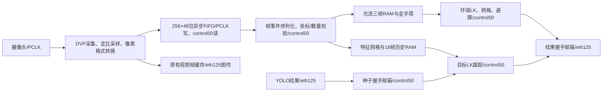

# LK/光流迁移至内部50MHz处理域

2026-10-31，用户批准 `LK_STABLE_CLOCK_PROPOSAL_20261031.md` 后实施。
本轮不使用电机，旧版状态异常证据保留在 `LK_FSM_HARDENING_20261031.md`。
迁移已接入 RTL；最终时序、回归和硬件结果见下方验证记录。

## 时钟与数据边界

`camera/clk50` 实际连接 PLL `CLKOUT0`，周期20ns；不是仅修改SDC频率。
LK、除法器、目标跟踪、环境网格、金字塔写入及风险计算均使用该时钟。
PCLK保留采集前端、FIFO写端和原有图传写端，不再运行LK/避障状态机。

FIFO记录原子传输 `{start,end,good,pixel,fid,x,y,luma,red}`。
组合标志和像素不会经过相互独立的总线同步器。读端先发start，再发像素，
最后等待4拍排空特征/金字塔写流水线再发end；同拍start/pixel/end也保持此顺序。
封帧前要求320×180个像素按坐标连续到达，帧号一致；不完整或错序数据不得发布为好帧。

## RAM所有权与失效

- 所有历史RAM、帧标签、sealed标志和处理读口都在control50。
- 环境三帧缓存继续保留处理租约；求解和结果排空期间，采集不能覆盖当前/前一帧。
- 目标16帧历史继续按完整帧标签验证；种子过期/覆盖规则保留。
- FIFO溢出采用保持电平的请求/应答，禁止继续写入，读端丢弃残留数据，握手完成后仅在新start恢复。
- 相机配置/PHY导致的采集复位通过同一协议使观测失效；不会异步复位LK主状态或清除黑匣子。
- PCLK停止时，稳定域100ms看门狗清空有效历史并发布失效；恢复后重新建立完整连续帧配对。
- 全局系统/PLL复位共同复位FIFO两端和邮箱两端，各域独立同步释放，避免单边清指针。
- 目标任务失效后仍等待在途patch结束，才允许下一任务启动；旧patch结果不被新任务接收。

避障超时改为50MHz下5,000,000拍，仍为100ms；诊断周期也按50MHz生成约10Hz。
原有控制接口、网络观测期限和电机门控保持独立。

## 高云约束与实现细节

Gowin的 `set_clock_groups` 优先于 `set_max_delay`。
因此PCLK与control50之间不再使用整个时钟组豁免，改为双向10ns最大延迟，
仅对FIFO/失效握手的首级同步D端取消异步Hold检查，保留全部Setup/最大延迟约束；
首级以后的同步路径仍进行Setup/Hold检查。
结果邮箱的held数据到接收数据端采用10ns有界延迟：请求经过两级同步后才锁存数据，
在最快eth125域最少有16ns稳定窗口，接收后源端还要等待应答返回才能更新。
此约束只覆盖held到dst_data，不覆盖请求或普通内部逻辑。
核验路由后的异常路径和Gray指针Q到首级同步D的实际延迟。
只对复位释放同步器的异步CLEAR端添加例外，不豁免其后的处理路径。
参考：[Gowin SUG940约束说明](https://cdn.gowinsemi.com.cn/SUG940E.pdf)。

金字塔行缓存的偶数行仅写、奇数行仅读。原来偶数行写入时读出的旧值未被使用；
移除该无效读取，避免综合生成GW5AT不支持的SPX9 read-before-write模式，算法数据不变。

既有B1非专用时钟引脚PR1014仍作为限定接线配置项记录。
eth125 MPW继续保留未决诊断状态，不修改PLL主时钟、不豁免MPW来宣称整体签核。

## 验证记录

### 数字与路由验证

- 新增完整320×180帧CDC测试，覆盖三组异步时钟比例、同拍标志/像素、精确特征、RAM租约、FIFO满、相机复位、PCLK停止、错序坐标和共同系统复位，全部通过。
- 四组邮箱时钟比例测试通过：在途held数据保持不变、无撕裂/无重复接收、最新合并结果最终到达、复位不重放旧消息，并验证最快接收时钟下至少16ns的稳定窗口。
- 全部光流数学回归通过：9组单尺度、13组金字塔用例逐点与固定点模型一致。金字塔用例最大1,346,530拍，50MHz等效26.9306ms；这是用例覆盖结果，不是任意场景的形式化最坏执行时间证明。
- 系统回归、完整顶层仿真和图传多拍暂停/UDP报文回归通过。完整顶层解码23条混合UART记录，CRC无错；此处驱动动作只存在于仿真测试台，上板不驱动电机。
- 实际综合网表中，两份patch主状态及目标tracker主状态均为唯一5个FF；处理模块未连接PCLK，FIFO四组指针同步级各9个FF且时钟归属正确。
- 实际网表的57,600像素CDC接口与RTL逐拍一致；相机复位/溢出行为一致；两份patch自恢复及目标patch五组RAM接口数学对照通过。这些网表仿真未加载SDF，物理延迟由STA另行核验。

| Place | 全局Setup违例 | 全局Hold违例 | control50最差Setup/ns | PCLK最差Setup/ns | 处理 |
|---|---:|---:|---:|---:|---|
| 2 | 0 | 0 | +4.944 | +2.098 | 保留并下载SRAM |
| 3 | 75 | 0 | +4.799 | +1.579 | 排除 |
| 4 | 709 | 0 | +4.970 | −0.090 | 排除 |

三者使用同一网表，Timing-Driven=1、Route=1、replicate_resources=0。
Gowin的自定义按域report_timing会替换默认Setup路径表，因此这里明确区分“全局违例计数”和“按域最差裕量”，不把+4.944ns标为全局WNS。

保留候选的18条Gray指针跨域数据路径全部核验，包含MSB被等价合并为二进制计数器MSB的情形；最慢1.539ns。
flow/observation/seed邮箱分别核验208/184/113条实际数据路径，最慢分别3.635/1.966/1.368ns，均满足10ns数据预算。
当前PCLK报告扇出为662，复杂求解和风险计算位于control50。

候选FS SHA256：`ca0d065c1c69120cd71c5d3d484a54ffb01851bd03393b468dcaaf805ec8eefe`。
网表SHA256：`4234931aa97dc051a968581bcfca9b1ea87dd6a8527d90cc0c8b02cf98757d98`。

### 实板并发窗口

实测300.817秒，共298个约1Hz状态采样；记录器无错误，静态采样健康检查通过。

| 指标 | 本次窗口 |
|---|---:|
| 环境LK故障锁存采样 | 0 / 298 |
| 新鲜且有置信度的状态采样 | 298 / 298 |
| 光流帧号推进 | 9,024 |
| PC / Nano收帧 | 29.985 / 29.919 fps |
| YOLO推理 | 23.752 fps |
| 采样到瓶子 / 有效目标LK | 292 / 262 |
| IMU新增CRC错误 / 序号缺口 | 0 / 0 |
| 最大采样控制观测年龄 | 46.126 ms |
| PC / Nano视频缺帧计数增量 | 4 / 22 |
| FPGA失效计数增量 | 4 |

按该窗口FPGA帧号范围进一步检查原始包：9,021条OFST和3,009条OFDG中，
环境故障锁存始终未触发；有4条短暂不可用/过期OFST，全部正确给出unknown、停车、速度0，未发现不可用数据被放行。
因此“298次采样均健康”不代表每一个原始报文都可用；本轮也覆盖了这些瞬态的失效屏蔽行为。

`dropped_frames`当前还累计采集未就绪时的失效通知，窗口开始绝对值为105,851，
不能把它当作已丢失105,851张实际图像。本轮按窗口增量4记录，初始化重复失效通知的计数语义仍是已知诊断限制。

目标LK的262个有效采样均同时有有效语义种子，真实class 39瓶子已带载。
本轮采样中red标志均未满足原有250‰颜色门槛，因此融合`target_valid`采样值为0；未把检测/跟踪带载当作颜色融合或自主导航验收。

电机12V保持断开，电机输出始终未使能；仅SRAM配置，不写Flash。
Nano恢复同一套39文件版本和原FP16模型，单独的UDP事件进程继续转发给PC。
PC本任务传感控制台因旧帧编号被重启，原串口网关保持运行。

本轮直接观测到的黑匣子为环境LK实例。目标LK通过真实瓶子种子和FSTA有效跟踪输出确认带载，其独立故障位尚未单独出网，不能宣称同时直接读取了两份黑匣子。
动态整车避障验收不在本轮静态测试结论内。此前存在五分钟正常后更晚触发故障的记录，因此新窗口通过也不能替代长期验证。

证据目录：`docs/evidence/control50_migration_20261031/`。
