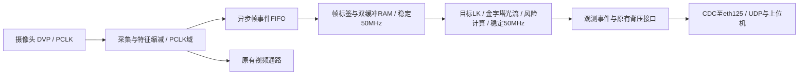

# 将LK处理与摄像头PCLK隔离（已批准实施）

已验证单份主状态、Gray关键边和寄存译码缓冲仍不能消除实板异常。
当前没有可信的PCLK波形测量，因此不把问题定性为抖动、复位或某一条Setup/Hold路径。
用户已于2026-10-31批准稳定50MHz路线。当前实施与验证结果见 `LK_CONTROL50_MIGRATION_20261031.md`；这份原始方案本身不作为验收通过的证据。

## 推荐路线：稳定50MHz处理域

- PCLK只承担DVP采集及必要的缩减，不再作为LK状态机、帧所有权和避障计算的处理时钟。
- FIFO记录携带帧号、开始/结束/有效标志、坐标和灰度。保留同周期标志与像素的关系，不能用互相独立的同步器传宽总线。
- FIFO读出后，在50MHz域写帧RAM、维护标签和双缓冲所有权，LK读口也在50MHz；原算法与控制接口尽量保留。
- 相机复位作为处理域的失效事件处理，不直接异步复位整个处理状态机。处理域复位来自稳定系统时钟域的复位逻辑。
- YOLO种子和结果接口原有CDC改接50MHz端，视频通路保留，控制部分保持未启用。
- 异步FIFO必须具有溢出报告与整帧失效机制；摄像头暂停或坏帧只能使观测无效、停车建议生效，不能让处理状态无限等待。

当前实板每帧计算约85万至103万拍，按50MHz估计约17～21ms，有希望维持30fps。
这是吞吐估计；还需覆盖最坏纹理、全部迭代和双任务并发后才能确认。
不会把原84MHz时钟仅在SDC中改写为50MHz；必须实际连接稳定的50MHz处理时钟。
既有eth125 MPW问题继续单独保留，不能因此宣布整个工程完成时序签核。

## 较小路线：先增加独立监测

先在稳定时钟域记录PCLK边沿计数/停顿、相机复位及初始化状态的变化，
给首次状态异常增加时间关联。它可以检查平均频率、时钟停顿与复位关联，
但不能替代对亚纳秒窄脉冲或信号完整性的可信测量，也不能保证直接修复异常。

## 无论选哪条路线

保留本轮失败数据，不以重启清除证据后重测来替代长期验证。
需要重新进行不同频率和相位下的CDC/帧所有权回归、固定点数学对照、PnR及实板测试。
此前曾出现五分钟无故障而更长时间后触发，因此新的五分钟通过只能作为窗口结论。
