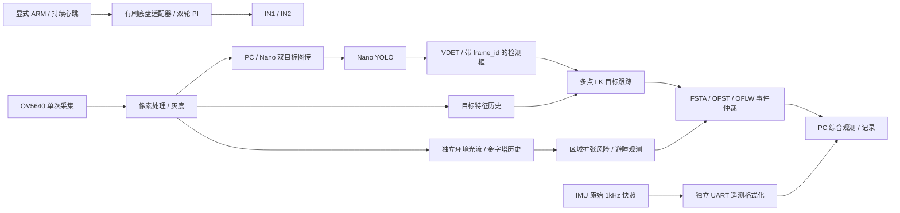

# 感知合并与底盘边界 — 2026-10-30

本次将 IMU、YOLO 检测反馈、多点 LK 目标跟踪、独立金字塔光流及避障观测放入同一工程。视觉来源固定为 `fpga-vision` 的 `df6f60d07873150d9ea796580adbc17960945f2c`，通过 Git 对象读取，不复制来源工作树中的临时文件。来源、原始 SHA256 和允许修改的适配文件见 `perception_sources.json`；更早的 `fpga-robot` 来源保留在 `integration_sources.json`。

## 数据路径



`fpga/system/system_top.sv` 负责平台装配。IMU 驱动、视觉网络复位和底盘控制各自独立；`fpga/control/brushed_chassis.sv` 不包含相机、IMU、目标类别或避障判断。原 `brushed_motor_top.sv` 独立调试入口保留，同样复用 `motor_core`、编码器、轮速 PI 和遥测模块。

相机只初始化/采集一次。`flow_observer.v` 从原 320×180 有效像素流每隔一个像素/行抽取 160×90 灰度。目标 LK 保留原 80×45 特征及 16 帧语义历史；环境光流使用独立三帧缓存和金字塔。两者复用 `flow_lk_patch.v` 的实现，当前综合为不同求解器实例，不声称共用同一个硬件执行单元，也不共用不兼容的图像缓存。

环境流保留来源的 `flow_pipeline`、`flow_avoidance`、事件格式化和独立网络时钟看门狗。避障输出是区域运动扩张风险代理，不是距离或 TTC，也没有 IMU 旋转补偿。低纹理、坏帧、不连续帧或超时返回 unknown/停车建议。目标的 `track_valid`、颜色过滤后的 `target_valid` 和避障建议分别保留。

`event_packet_mux.v` 以完整 256 位包仲裁 FSTA 与 OFST/OFLW。输出背压时保持不变，连续目标事件不会饿死光流事件。每个来源仍有自己的最新值合并及超时；OFLW 是诊断采样，允许合并丢弃，不作为控制完整性依据。

为处理合并后STA暴露的长路径，适配文件包含：LK前后向一致性检查与点缓存写入分拍、反向中心坐标在启动求解器前寄存、排序读取/比较/交换分拍；目标/光流/语义超时比较寄存，保持既定截止行为；ARP请求预判与派发分拍并在派发时检查端点；IP校验和两级进位折叠、发送头与载荷及帧缓存字节选择并行译码。观察器端点状态延迟一个125MHz时钟（8ns），网络准入与最终发送仍检查当前端点。上述适配均记录在来源清单；没有新增整模块时序例外。

## 通用接口与可复用范围

| 边界 | 内容 | 单位/时效 | 替换平衡底盘时 |
|---|---|---|---|
| IMU 原始接口 | ax/ay/az、gx/gy/gz、sample_seq、timestamp_us、sample_valid、fault/stale | 原始有符号 16 位，约 1kHz，原子提交 | 保留采集；在 FPGA 内消费快照，标定车体轴向/零偏 |
| 图像目标 | 检测/跟踪框、类别、语义帧号、跟踪帧号、质量、失效原因 | 原图 1280×720 坐标；FSTA v2，独立超时 | 保留 |
| 环境运动 | x/y/u/v、有效性、区域有效点/风险点、状态 | 160×90 图像坐标，硬件 Q7；OFST/OFLW v1 | 保留 |
| 避障约束 | stop_request、steer、speed_limit、age/fresh/confident | steer −1左/+1右；速度建议 0…255，绝不是 PWM | 交给行为策略处理，不直接接执行器 |
| MotionIntent | v_mm_s、w_mrad_s、issued_ms、valid_for_ms、source | +v前进、+w左转；本机单调时钟，最多200ms | 保留上层意图，替换底盘适配器 |
| 有刷适配器 | 运动学/计数换算、轮速反馈、PI、PWM、STOP/看门狗 | 计数/10ms、PWM‰ | 替换为平衡车状态估计/速度外环/平衡内环及对应执行器 |

`shared/motion.py` 提供实际可调用的 `MotionIntent`、约束计算和 `DifferentialDrive` 换算。轮距、轮径、每转计数、反馈符号及输出计数限值必须由调用者提供；不会为未知轮距填默认值。左右轮同时饱和时按比例缩放以保留曲率。过期或未来时间的意图返回零。

本轮不把该通用接口接进自动运动链。现场手动调参继续使用原租约/ARM/轮速心跳协议；新感知只能改变观测状态，不能发送 ARM 或轮速。后续需要实现行为策略，再通过底盘适配器及原控制所有权/超时机制执行。平衡车的停车应由平衡控制器定义为零行驶意图并保持必要的平衡；不能照搬有刷车 STOP 后断开 PWM 的处理。

IMU UART 遥测约50Hz，只供显示。未来平衡内环必须直接消费 FPGA 内的约1kHz原始快照，不应依赖 Wi-Fi、PC 姿态图或降采样串口。当前传感器相对车体的安装变换尚未标定；不在本轮新增平衡环。

## 当前硬件配置与软件入口

统一顶层 PWM 上限为350‰，保持已验证的轮速环/超时/编码器恢复配置。左编码器P7-31/F16、32/E17；右编码器P7-27/C18、36/D19；四路内部上拉。IMU P7-39/F19、40/F20。电机控制P7-21…24。P7-25/26、37不作为当前输入，旧无刷EN/PWM/CAL全部固定低。

PC 综合页面入口仍为 `host/dashboard.py`，默认离线，通常监听8872；电机调参台8874独立保留。综合页面新增光流矢量、区域有效/风险计数、停车/转向建议和速度归一值。PC 与 Nano 的 `shared/perception.py` 根据包头分别解析 FSTA、OFST、OFLW；Nano 的 `/api/result` 同时提供 tracking 和 flow。PC 给缓存继续计时，200ms后把光流显示遮罩为 unknown/停车；重复同帧 FORWARD 不能续租，同帧 STOP立即生效。

YOLO 模型/推理后端仍显式指定现有引擎。网关独占串口，YOLO独立进程；没有语义导航、SLAM或自动跟随。Nano代码准备包不含模型、凭据或位流，也不自动部署。

## 可复现验证

```powershell
python tools/shared_check.py
python tools/test_system.py
python tools/test_perception.py
python tools/test_full_top.py
node tests/test_perception_ui.js
python tools/build_system.py
python tools/prepare_nano.py --output dist/nano_system_merged_20261030
```

位精确光流测试使用来源标量模型；包含9组单尺度工况、13组金字塔工况、缓存所有权/坏帧/过载/回绕及避障迟滞/失效。合并事件台验证公平性、背压、停钟超时及端点失效，并把输出交给生产Python解析器。数字完整顶层使用行为IMU/PLL、缩小视频缓冲与像素注入；电机/UART计数器加速10倍，IMU遥测测试台降采样改为4（生产为20，另由独立motor+IMU测试覆盖），检查电机/IMU/网络故障隔离；不等同真实相机双算法并发性能验收。

超时回归额外检查截止前有效、到期失效、到期刷新，以及摄像头停止后的检测结果拒绝。`--events-only`仅在光流算法、标量模型和测试台的哈希与最近完整成功回归完全一致时复用算法结果；来源变化必须重跑完整算法回归。

图传载荷测试直接实例化双时钟`vision_frame_stream`，逐字节检查16行真实缓存输出中的CV包头、帧号/行号、RGB565字节序、上下黑边及任意发送暂停。网络回归另检查47个实际以太网帧的负载、FCS及IP校验和。

上位机通过4组Node状态/交互回归。Edge/Playwright离线检查桌面1440×1000和手机390×844布局，无横向溢出；正常运行时控制台错误/警告均为0。预览服务只监听本机离线端口8892，检查后停止，未占用8874实车调参入口。

## 本轮结果与未决项

功能合并完成；49项Python测试、10组电机RTL台、LK跟踪、9组单尺度/13组金字塔光流、避障/超时/事件仲裁、47帧网络、图传载荷、4组UI及完整数字顶层回归通过。完整顶层解出23个混合遥测包，CRC=0。源码哈希随结果归档，Nano准备包36个文件通过Python3.6语法及启动入口检查，尚未部署。

最终布线尝试`20261030T093804Z`生成位流，但**Setup=18、Hold=0、最差Setup −0.235ns**，不满足下载门槛。剩余路径涉及图传行缓存→UDP输出、避障风险计数、语义帧龄以及部分计数器/发送控制。前一尝试曾到Setup=10/最差−0.054ns，但不能将旧结果套到当前源码。资源为Logic25485/138240（19%）、寄存器22473/139095（17%）、BSRAM218/340（65%）、DSP64/298（22%）；不是资源容量不足的结论。

另外，来源已有的eth125 BSRAM最小高脉宽仍为actual0.212ns/required0.900ns、裕量−0.688ns；相机PCLK通用路由PR1014仍存在。没有豁免、掩盖或声称完整STA通过。后续需收敛这些检查，再按动力隔离流程下载并做传感静态/真实相机并发测试；本轮不进入自动运动验收。

详细本轮结果及适用边界见 `docs/evidence/perception_merge_20261030/summary.json`。位流SHA256为`766f187f9a3d13a9bb60e2dd263b58ba253e47999f6314f78098eb63a8f9b17f`，仅用于识别失败候选。本轮没有下载FPGA、重启车载服务或转动车轮。
