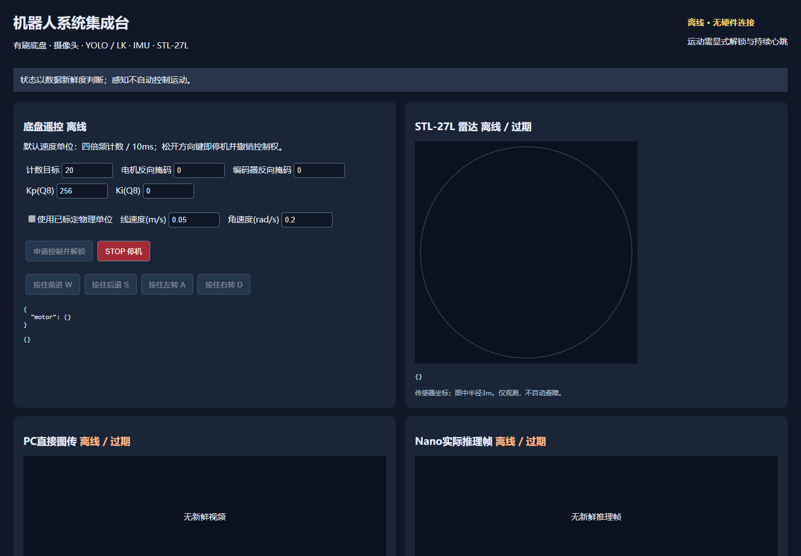

# 第一阶段系统集成验证 — 2026-10-29

## 当前ADC改线版本

D157B改用P7-21~27及36/37；原无刷端口不复用，两路EN、12路PWM、两路CAL全部固定低。69个集成顶层引脚唯一；综合网表逐一确认16个旧驱动控制输出接GND；独立电机与完整顶层仿真均在整个运行窗口持续断言这些输出为0。

19项Python测试、5组RTL测试、LK/双目标网络及完整数字顶层回归通过。ADC改线版重新综合布线Setup=0、Hold=0，最差Setup裕量仍为+0.026ns；最小高脉宽−0.688ns和相机时钟路由告警仍未豁免，完整时序签核未通过。当前位流SHA256为`9c1a7b13d8c0b30552ab414b4f783d3fae37349e3a3b00eef176ce927de5f0ab`。

当前证据在[adc_remap_v2](evidence/adc_remap_v2/build.json)，包括约束、69引脚表、16路旧输出检查、回归哈希和完整时序报告。接线以[当前引脚表](pin_plan_v0.md)为准：拔下旧ADC数字接口，从载板侧引线；释放原雷达TTL接口。未下载、未实测电平或使能，实物修订版仍需核对，旧无刷动力支路建议断开。

## 以下为改线前system_v1历史记录

下列55引脚证据保留为历史版本，不适用于当前接线。

软件和RTL已实现，19项Python测试、5组RTL测试、LK/网络回归、完整数字顶层仿真及离线页面检查通过。Gowin V1.9.12.04综合布线Setup=0、Hold=0，源码与位流哈希已归档；完整时序签核仍有下面的脉宽项，不能发布可直接上板的结论。

## 时序结果与未决项

- 目标维持50MHz控制、约84MHz相机PCLK、125MHz网络；速度环100Hz、PWM10kHz。使用原始冻结LK源码及厂商BSRAM重定时，没有新算法、降频或宽泛时序例外。
- 最差Setup裕量+0.026ns；Logic 19354/138240（14%），寄存器16568/139095（12%），BSRAM 185/340（55%），DSP 36/298（13%）。55个顶层引脚唯一，两路旧使能在实际综合网表中为GND。
- **未决：eth125 BSRAM高脉宽裕量−0.688ns，报告actual=0.212ns、required=0.900ns。** 来源fpga-robot的已有布线报告存在完全相同数值，但这不能作为豁免依据。Late/Early时钟传播和PLL模型须进一步核对或取得厂商支持的处置依据；没有关闭或掩盖该检查。
- 还存在PR1014相机PCLK部分通用路由告警；外部DVP/RGMII延时是来源初始假设，TX接收窗口、电气和PVT另行核对。因此只确认方案要求的Setup/Hold端点门槛，**不宣称完整时序或硬件验收通过**。
- 完整报告、约束、TCL、网表/位流哈希和[时序审计](evidence/system_v1/timing_audit.json)见`docs/evidence/system_v1`。位流SHA256：`fc824a46ea7858ca7b89137b9a7bd30db9a5510dc7125631ab95f2700f0f20d9`。

## 功能证据

- 独立电机协议兼容，混合UART按完整48字节包仲裁，电机20Hz、IMU约100Hz，内部IMU约1kHz。
- 55个集成顶层引脚无重复；不可修改来源快照与实际读取哈希一致。
- 控制协议、实际串口工作线程的模拟设备测试、鉴权、心跳/状态失联、陈旧命令、计数器跳变、标定与里程计门控通过。
- 原LK回归通过；双目标网络回归逐字节检查47个以太网帧，包含重复发送、独立停用、目标快照、TTL和坏包拒绝。
- 完整生产层级数字仿真通过：15个IMU样本、18个控制周期、285919个网口发送字节；摄像头停钟、网络复位、IMU故障与手动运动控制隔离，急停关闭输出。仿真使用行为传感器/PLL、缩小图像缓冲、处理后像素注入，并加速电机/UART计数器10倍，不声称模拟板级电气或真实动态性能。
- STL-27L历史原始文件回放：9006个数据包、48圈完整扫描、CRC=0；没有在本轮接入雷达，也未确认距离绝对精度。
- Edge/Playwright实际页面检查：离线解锁、方向按钮、物理单位控制禁用；无新鲜图像时隐藏；桌面1440×1000无横向溢出。见下图。

本轮未部署Nano、未连接真实串口、未下载FPGA、未运行电机。两轮底盘及30分钟动态验收仍待实物执行，历史单模块验证和离线结果不能替代。

2026-10-29 更新：有刷工程已移除外部许可输入与开环分支；当前保护回归使用软件 STOP、复位和看门狗。历史表中的“异步急停”仅描述旧版结果，不能作为新固件的外部许可功能。新版本实车轮速闭环仍未验收。
