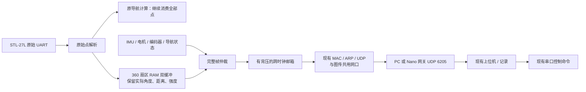

# 360 点雷达与以太网状态上传：离线交付

2026-11-02，Asia/Shanghai。

用户确认：所有状态数据改走千兆以太网，电机控制命令暂留现有串口链路。随后用户说明另一流程正在调试同一板卡，要求本轮只完成离线方案、暂不下载。本轮没有编程板卡、写 Flash、复位板卡、切换上位机进程或发送运动命令。

显示范围已先修复并同步到当时运行的两个页面；这项修复不需要更换固件。360 点和网口上传已经完成代码、数字验证及静态诊断版布局布线，等待后续统一上板。

## 显示结果

- 主观测台和导航诊断台都提供“自动适配 / 3m / 5m / 10m / 25m”半径选项，默认自动适配全部有效回波。
- 页面显示有效点数、实际画出点数和超范围点数，固定范围裁掉远墙时可以直接看见原因。
- 根据收到的协议显示 72 点/5° 或 360 点/1°；360 点版标明保留实测角度。
- 默认自动适配用当前有效点的最远距离向上取整到米。界面离线时清掉旧点，不连线伪造墙面或地图。
- 当前运行目录仍为原来的 `tmp/m2_mpu_20261102T063953Z`。首次范围修复的页面备份保存在 `output/lidar_diagnosis_20261102/range_ui_backup`。另一流程此后重启过原上位机，本轮没有接管进程。

## 数据通路

雷达传感器自身仍通过原有 921600 UART 接 FPGA。取消的是 FPGA 向上位机上传状态时的 115200 带宽限制，电机指令的串口接收路径保持原协议。

`system_task4_top` 默认 `TELEMETRY_ETHERNET=1`，使用 360 点输出；设置为 0 可运行旧 72 点/UART 状态模式。新的静态顶层为 `m2_sensor_eth_diag_top`，只用于传感器验收，十二路电机输出均固定为低，没有控制命令入口、相机或运动导航功能。它不能替代完整融合顶层。

## 360 点和缓存

实现：`fpga/navigation/lidar_scan_360_source.sv`。旧的 `lidar_scan_source.sv` 保留，未用新功能覆盖其 72 点兼容实现。

- 每 1° 一个扇区，每圈 360 个代表点。仍取有效回波中最近的一个，但上传它的实际 0.01° 角度，不再统一移到扇区中心。
- 单个 1024×40 同步 RAM 存双 Bank，每点保存角度 16 位、距离 16 位、强度 8 位；输入保留 32 点 FIFO 和错误/丢点 epoch。
- 换圈交换 Bank，逐地址清空；没有整圈复制、整圈同时清零或大规模异步多路读。
- 覆盖不少于 300/360 扇区、无解析错误、无 FIFO 丢点、角度连续时才发布。缺回波扇区以距离/强度 0 表示，不编造点。
- 最多约 10 圈/s；上传中的快照有 400ms 有效期。背压、坏圈和过期扫描通过诊断计数/标志反映。
- 这仍是最近回波显示，不包含去噪、运动畸变补偿、多帧建图或 SLAM。原导航对原始点的处理规则没有改成显示扇区规则。

## UDP 协议与网关

同一板载 MAC 上传电机、编码器诊断、编码器轨迹、IMU、导航状态、雷达分块和雷达接收诊断七类状态。UDP 源端口/目的端口均为 **6205**，目的 IP 复用现有第二目标的 ARP 身份；图传端口保持独立。

每个 UDP 数据报固定 64 字节：

| 偏移 | 字节数 | 内容 |
|---:|---:|---|
| 0 | 4 | ASCII `TLM1` |
| 4 | 1 | 版本 1 |
| 5 | 3 | 保留，必须为 0 |
| 8 | 4 | 传输序号，大端，32 位循环 |
| 12 | 4 | 源侧运行时间 ms，大端，32 位循环 |
| 16 | 48 | 保留原有端序、内部 CRC16 的完整混合状态帧 |

新版雷达分块：`C3 3C 05 02`；每圈 60 片，每片 6 点。

| 帧偏移 | 内容 |
|---:|---|
| 4～5 | 扫描序号，小端 uint16 |
| 6 / 7 | 分块序号 0～59 / 分块总数 60 |
| 8～9 | 快照帧龄 ms，小端 uint16 |
| 10～13 | 同一圈捕获时间 ms，小端 uint32 |
| 14 / 15 | 点数 6 / 扇区分辨率 1° |
| 16～45 | 6 组 `<HHB`：实测角度×100、距离 mm、强度 |
| 46～47 | 原 CRC16，小端 |

新版雷达诊断为 `C3 3C 06 02`，布局沿用原诊断，覆盖数允许 0～360。Python 解码器兼容旧 V1。

`shared/telemetry_udp.py` 检查来源 IP/端口、长度、封装和内部 CRC，拒绝重复和回退的传输序号，统计缺包和过期包。源时间展开支持回绕，并给小幅时钟漂移有限预算；乱序/重复包不会刷新状态新鲜度。FPGA 或遥测时钟复位后，网关应明确重连，避免旧控制租约被自动恢复。分块缺失时不发布不完整扫描，后续完整新圈可以恢复。

网关使用 `telemetry_transport="udp"` 时，串口线程只下发既有控制包，不读取状态；状态由 UDP 线程处理。电机新鲜度、失联停车和 ARM 流程继续生效。记录文件中的 `fpga_uart.bin` 为兼容旧回放保留名称，UDP 模式写入的是解封后的原始 48 字节状态帧；事件日志同时保存接受的 UDP 报文。

## 带宽

360 点、10 圈/s：每秒 600 个 UDP 数据报，应用数据约 38.4KB/s。按每包 64 字节应用数据，加 Ethernet/IPv4/UDP/FCS、前导码和帧间隙共 66 字节计算，雷达扫描部分约 **0.624Mb/s**，占千兆线速约 **0.0624%**。其他状态和视频另计。这是协议预算，本轮未实测网卡吞吐或并发板载视频。

## 通过的离线验证

1. `python -m unittest discover -s tests -p test_telemetry_udp.py`：6 项通过，涵盖来源/CRC、重复与乱序、回绕、过期、长时间时钟漂移、缺片、跨圈、捕获时间一致性和网关分流。
2. `python tools/task4/test_ethernet.py`：真实扫描 RAM → 帧仲裁 → 异步邮箱 → 生产 UDP MAC，两个完整 360 点圈逐点一致；实测角度、相同距离的先到点保留、背压和 UART 空闲检查通过。并发 1456 字节视频逐字节一致，Ethernet FCS、IPv4 和内层 CRC 全通过。
3. `python tools/task4/test_ethernet_top.py <已冻结构建目录>`：实际静态顶层七类状态全部通过 UDP，360 点逐点一致，MPU 数字模型产生有效样本，十二路电机输出固定低、UART 状态发送保持空闲。数字夹具替代 PHY ready/恢复后的 GMII 输入，IMU 调试抽样夹具为 2，生产为 20；不能将其当作电气、PHY 协商或真实 IMU 验证。
4. 原有 72 点 RAM 回归、原 UART 解析到显示端到端测试、导航诊断台测试及网关控制测试通过。
5. 原双目标网络回归通过：47 个 Ethernet 帧校验，21 份视频目标副本；ARP 独立缓存、目标更新、停止/清缓存、坏包拒绝和 TTL 行为保持正确。
6. 完整 `system_task4_top` 默认以太网模式已通过 Icarus 层次展开；完整融合顶层本轮只冻结候选源码，尚未完成其本轮 PnR 或实板并发验收。
7. Nano/shared 模块通过 Python 3.6 语法检查；独立部署包可以在隔离 Python 进程中导入网关。

主要证据：

- `build/lidar_eth360_20261102/regression.json`
- `build/lidar_ethernet_20261102/diagnostic/20261102T094300Z/test_result.json`
- `tests/network_dual_20261014/verification.json`

## 已完成的实际布局布线

通过版本：`build/lidar_ethernet_20261102/diagnostic/20261102T094300Z`。

- 顶层 `m2_sensor_eth_diag_top`，GW5AT-LV138PG484AC1/I0，M2 引脚配置。
- Setup / Hold 违例 **0 / 0**；最差 Setup 裕量 **+1.037ns**；最小脉宽裕量 **+0.021ns**；无 PR1014 时钟布线告警。
- 网表确认十二路电机物理输出均接 GND；静态顶层无命令接收入口。
- 位流 SHA256：`63dc4e2b3ae47e2a98eaa6d465578207e9ba09fa28acbed128029ac23a67d49e`。
- Gowin 完成报告/位流后 CLI 滞留，构建工具仅结束其自己创建的进程；原退出状态与完成标志保留在结果中。数字验收没有忽略实际 Setup/Hold 或脉宽违例。

与此前已运行的 72 点静态诊断版按布线报告同口径比较：

| 资源 | 72 点 UART 静态诊断版 | 360 点 Ethernet 静态诊断版 |
|---|---:|---:|
| Logic（LUT/ALU） | 10159 / 138240，8% | 15300 / 138240，12% |
| 寄存器 | 11631，9% | 17678，13% |
| BSRAM 利用率 | 3% | 4% |
| DSP 利用率 | 2% | 2% |

新静态版本增加了整个 PHY/MAC/ARP 通路，不能把这一增量直接当作已含网口的视觉融合工程增量；完整融合工程仍需独立 PnR。扫描源与输入 FIFO 综合为 BSRAM，没有退回成整圈寄存器多路器。

125MHz 路径的实际修改包括：ARP 重试使用毫秒计数，宽报文锁存与准入条件分开，视频目的选择加寄存级，ARP CRC 直接消费已锁定的帧体，校验扫描下标去除不必要的复杂使能。没有降低网口时钟或用放宽同步路径约束来掩盖违例。新增邮箱按双向握手约束稳定数据的最大延迟，单独排除该握手总线的虚假同边沿 Hold 关系；普通同步逻辑仍按原周期检查。

## 后续统一上板步骤（本轮未执行）

1. 结束另一流程的板卡操作，明确选择静态传感器验收版或完整融合版。静态 `.fs` 不包含相机/运动任务，不能当作整机融合镜像。
2. 使用 `tools/task4/build_ethernet.py` 冻结、构建静态版；完整融合版使用 `--system`，并通过既有 control50、LK 状态和 CDC 审计。`--prepare-only` 只准备工程。
3. 静态 SRAM 工具为 `tools/task4/program_ethernet.py <构建目录>`，要求时序、冻结源码及完整顶层仿真一致。该工具不写 Flash。本轮没有调用它。
4. 状态接收地址可选 PC `192.168.50.10` 或 Nano `192.168.50.20`。先选择唯一接收网关，监听 UDP 6205，避免与另一网关争抢串口或端口。
5. 使用现有第二目标配置或 `tools/task4/telemetry_endpoint.py --bind <本机IP> --target <状态接收IP>`。默认保留第二目标的图传端口；不要为迁移状态数据误改已运行的图传目标。
6. `config/nano.m2.ethernet.example.json` 为网关样例，命令串口填写实际设备。PC 继续通过原网关 HTTP 接口查看状态，不需要各页面分别抢 UDP。
7. `tools/task4/verify_ethernet.py --bind <本机IP> --seconds 20 --output <新目录>` 可直接只读验收 UDP；它需独占接收端口，应在正式网关接管前运行。真实雷达、丢包/坏包、显示、视频并发及真实 IMU 状态均待现场确认。

已准备但没有启动的本机运行目录：`E:/Gowin_project/fpga_project/tmp/lidar_eth360_live_20261102`。当前板卡和旧上位机进程继续由另一调试流程管理。
